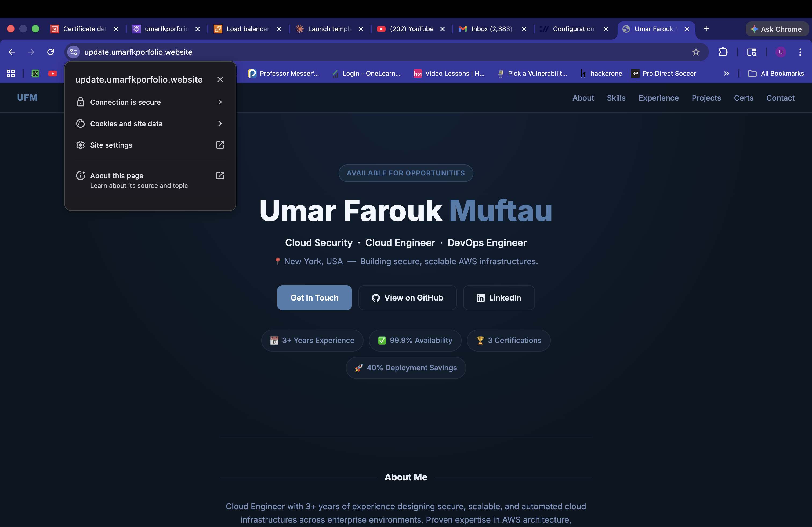
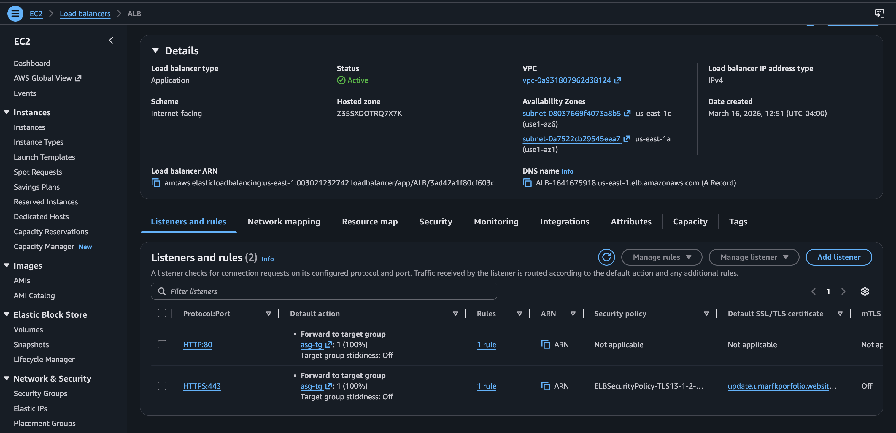
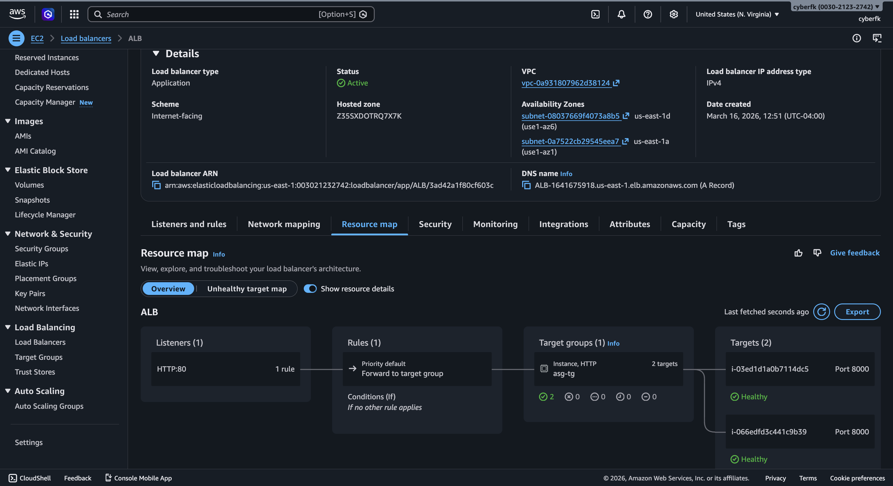
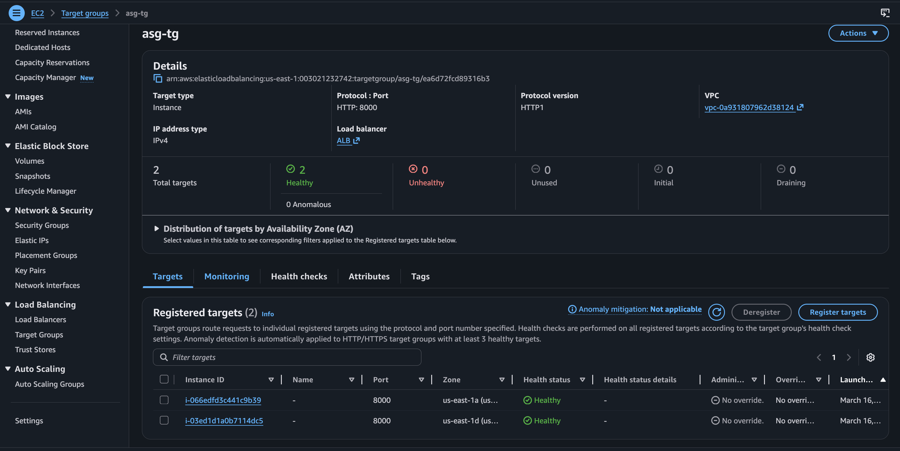
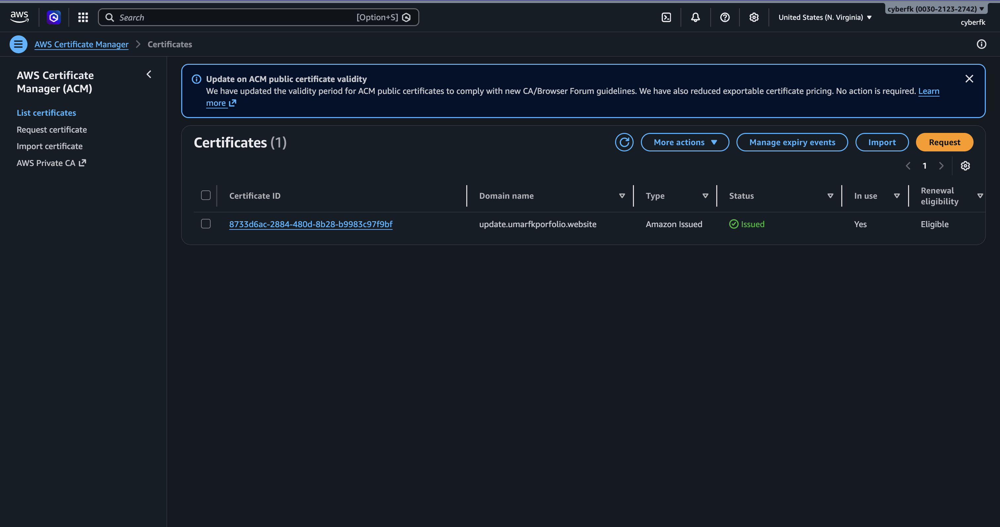
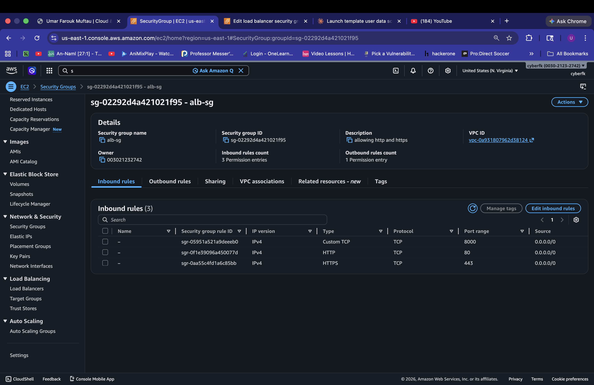
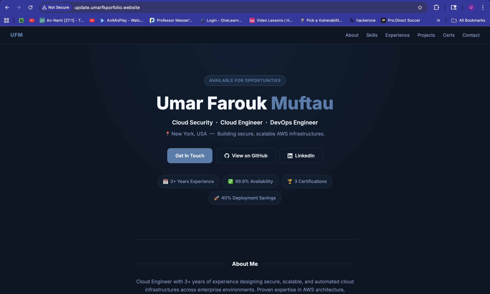

# Flask Portfolio — AWS EC2 + Auto Scaling Group + ALB + HTTPS


Personal portfolio for **Umar Farouk Muftau** — Cloud & DevOps Engineer.
Deployed on AWS using Auto Scaling Group, Application Load Balancer, and HTTPS via ACM.

**Live:** https://update.umarfkporfolio.website

---

## Architecture

```
Internet
    │
    ▼
Route 53  (update.umarfkporfolio.website)
    │
    ▼
Application Load Balancer  [HTTPS :443 / HTTP :80]
    │
    ▼
Target Group  (asg-tg — HTTP :8000)
    │
    ├── EC2 Instance — us-east-1a  ✅ Healthy
    └── EC2 Instance — us-east-1d  ✅ Healthy
              ↑
    Auto Scaling Group
    (min 1 / desired 2 / max 3 — CPU 70%)
```

---

## Tech Stack

| Category        | Technology                  |
|-----------------|-----------------------------|
| Backend         | Python / Flask + Gunicorn   |
| Compute         | AWS EC2 (Ubuntu)            |
| Scaling         | Auto Scaling Group (ASG)    |
| Load Balancing  | Application Load Balancer   |
| DNS             | Route 53                    |
| SSL/TLS         | AWS Certificate Manager     |
| Automation      | Bash (User Data Script)     |
| Version Control | Git / GitHub                |

---

## Project Structure

```
Flask-Portfolio-AWS-ASG-ALB-HTTPS/
├── app.py            ← Flask application (serves on port 8000)
├── run.sh            ← Creates venv, installs deps, starts Gunicorn
├── user-data.sh      ← EC2 bootstrap script (runs on launch)
├── requirements.txt  ← Python dependencies (Flask + Gunicorn)
└── README.md
```

---

## Screenshots

### ✅ Live Site — HTTPS with Green Padlock


### ✅ ALB — Active with HTTP & HTTPS Listeners


### ✅ ALB Resource Map — 2 Healthy Targets


### ✅ Target Group — 2 Healthy Instances on Port 8000


### ✅ ACM Certificate — Issued for update.umarfkporfolio.website


### ✅ ALB Security Group — Ports 80, 443, 8000


### ✅ Site Running via HTTP (before SSL)


---

## Deployment Steps

### 1. Push Code to GitHub
```bash
git init
git remote add origin https://github.com/umarfarouk16/Flask-Portfolio-AWS-ASG-ALB-HTTPS.git
git add .
git commit -m "Flask portfolio with ASG + ALB deployment"
git push -u origin main
```

### 2. Create Launch Template
- AMI: Ubuntu (latest)
- Instance type: `t2.micro`
- Security group `asg-app-sg`: ports **22** and **8000**
- User data: paste `user-data.sh`

### 3. Create Auto Scaling Group
| Setting  | Value |
|----------|-------|
| Desired  | 2     |
| Minimum  | 1     |
| Maximum  | 3     |
| Policy   | CPU Target Tracking 70% |

### 4. Create Target Group
- Protocol: HTTP | Port: `8000`
- Health check path: `/`

### 5. Create Application Load Balancer
- Internet-facing, 2 subnets across 2 AZs
- Security group `alb-sg`: ports **80** and **443**
- HTTP:80 listener → forward to target group
- Attach ASG to target group

### 6. Configure DNS
- Route 53 → A alias record → `update.umarfkporfolio.website` → ALB

### 7. Add HTTPS via ACM
- Request certificate for `update.umarfkporfolio.website`
- DNS validation → Create records in Route 53 → wait for **Issued**
- ALB → Add HTTPS:443 listener → select ACM cert

---

## Local Development

```bash
git clone https://github.com/umarfarouk16/Flask-Portfolio-AWS-ASG-ALB-HTTPS.git
cd Flask-Portfolio-AWS-ASG-ALB-HTTPS

python3 -m venv venv
source venv/bin/activate
pip install -r requirements.txt

python3 app.py
# Open http://localhost:8000
```

---

## Auto Scaling Behavior

| Traffic Level | Instances |
|---------------|-----------|
| Low           | Scales down to 1 |
| Normal        | Maintains 2 |
| CPU > 70%     | Scales up to 3 |

---

## Cleanup

Delete in this order to avoid charges:
```
1. ALB
2. Target Group
3. ASG  →  set desired/min/max = 0 first, wait, then delete
4. Launch Template
5. ACM Certificate
6. Route 53 record
```

---

## Author

**Umar Farouk Muftau** — Cloud Security Engineer · Cloud Engineer · DevOps Engineer

[GitHub](https://github.com/umarfarouk16) · [LinkedIn](https://www.linkedin.com/in/umar-farouk-muftau-5621ba185/) · umarmuftau16@gmail.com
